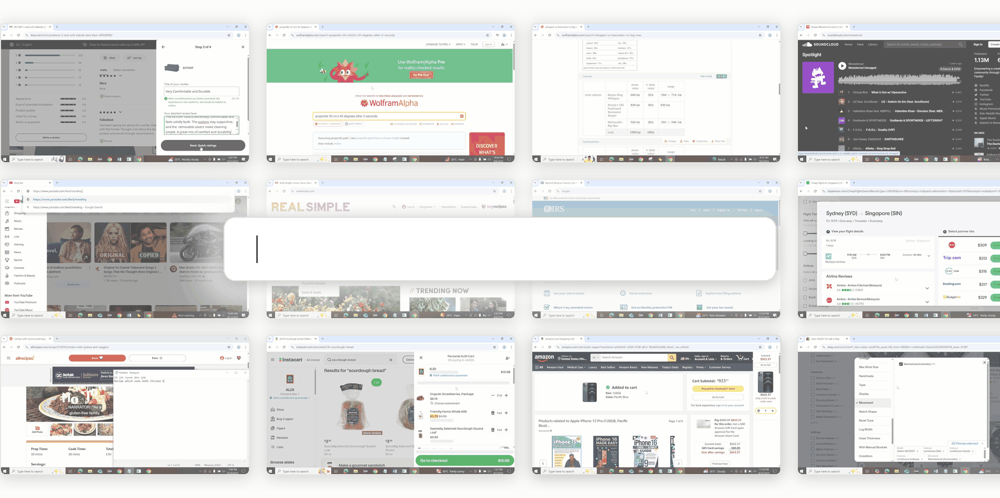

<h1 align="center">&nbsp;StreamEmbed</h1>
<h3 align="center"><a href="https://arxiv.org/abs/2611.18516">Real-time Indexing from Pixels for Screenshot Retrieval</a></h3>

<p align="center">
  <a href="https://dayoon-ko.github.io/">Dayoon Ko</a><sup>B,S</sup>,
  <a href="https://yichuan-w.github.io/">Yichuan Wang</a><sup>B</sup>,
  <a href="https://starsuzi.github.io/">Soyeong Jeong</a><sup>K</sup>,
  <a href="https://people.eecs.berkeley.edu/~jegonzal/">Joseph E. Gonzalez</a><sup>B</sup>,
  <a href="https://vision.snu.ac.kr/gunhee/">Gunhee Kim</a><sup>S</sup>,
  <a href="https://www.sewonmin.com/">Sewon Min</a><sup>B</sup>
</p>
<p align="center"><sub>
  <sup>B</sup>University of California, Berkeley &nbsp;
  <sup>S</sup>Seoul National University &nbsp;
  <sup>K</sup>KAIST
</sub></p>

<div align="center">

[](https://arxiv.org/abs/2611.18516)
[](https://pypi.org/project/streamembed/)
[](https://huggingface.co/datasets/dayoon/ScreenMemEval)
[](LICENSE)

</div>

<p align="center"></p>

StreamEmbed finds a past screen from a question such as *"Which smartphone model did I add to my cart?"*.

It embeds a screenshot every 5 s into an index on your laptop. Since it runs while you work, it should take only a small share of the laptop's time and memory. StreamEmbed cuts the time per screenshot from 2.3 s to 0.6–0.8 s by exploiting the redundancy in the stream of screenshots:

- Spatial redundancy: blocks that repeat a neighbor are dropped (spatial pruning).
- Temporal redundancy: blocks unchanged since the previous screenshot reuse their computation (temporal reuse).
- A Consistency adapter keeps the embedding close to that of the full screenshot.

On an Apple M2 Pro it embeds a screenshot 2.8–3.7× faster than Qwen3-VL-Embedding-2B and keeps over 98% of its Recall@10 on ScreenMemEval.

## Our paper

https://github.com/user-attachments/assets/96c22d07-b3c6-4292-8cdf-39790d98d265

## Run it on your laptop 🚀

### From the terminal

```bash
uv tool install streamembed
streamembed start --folder {folder}        # index the screenshots saved in {folder}, then capture every 5 s
streamembed search "Which smartphone model did I add to my cart?"
```

### From Python

```bash
uv pip install streamembed
python run.py
```

https://github.com/user-attachments/assets/b61726b2-2e0a-4756-8ae8-9e326c1b3b63

<br>

## Ask Claude Code about your screen 💬

[`mcp_server.py`](mcp_server.py) gives Claude Code a tool that searches your screen history and looks at the screens it finds. Add it with

```bash
claude mcp add streamembed -- uv run --python 3.12 --with streamembed --with mcp python /path/to/StreamEmbed/mcp_server.py
```

Then ask, for example, *"Which smartphone did I add to my cart yesterday? Check my screen history."* The server searches the index that `streamembed start` keeps. While that service runs, it embeds the question with the service's model; otherwise it loads the model on the first search (20–60 s).

## Reproduce the paper

[`reproduce/`](reproduce) has the code that reproduces the paper's tables from ScreenMemEval with the `streamembed` library.

## Library

The source of the [`streamembed`](https://pypi.org/project/streamembed/) package is in [`library/`](library).

## License

Apache-2.0. The model weights and the dataset have their own licenses.
